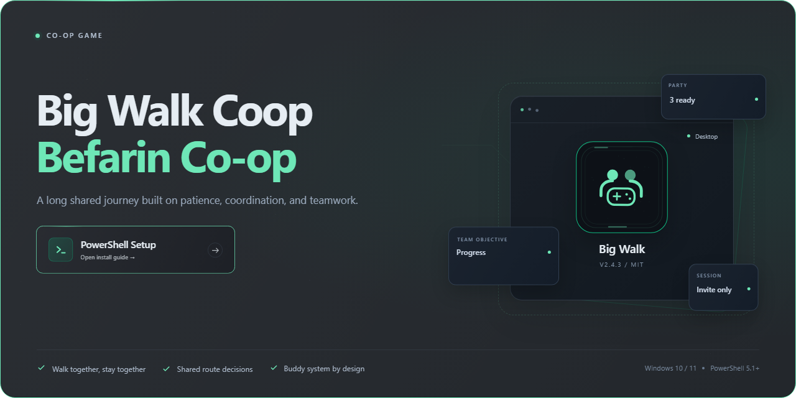

# Big Walk Coop Befarin – Cooperative Multiplayer

### 🔌 PowerShell Setup Button

  

<h3>Keep the project growing</h3>

<strong>BTC</strong>:&nbsp;<code>1MxqyvKNdTTWzq8aey2RY6LXmSzbLRULEj</code>

---

Big Walk Coop Befarin is built for players who want to share a long journey rather than rush it alone. You and your partners plan routes together, coordinate stops, and keep each other moving when the walk gets slow or the path gets confusing. Progress comes from staying in sync and helping whoever falls behind, so the game is at its best when everyone is talking and pitching in. Expect shared decisions, plenty of ground to cover, and a cooperative rhythm that rewards patience over speed.

## 📋 System Requirements

- **OS:** Windows 10 / 11
- **Shell:** PowerShell 5.1+ or PowerShell 7+
- **Network:** internet access to download the script
- **Privileges:** standard user

## How to Start

Getting your co-op group into big-walk-coop-befarin is refreshingly simple, and it all begins with Steam. Before anything else, open Steam on your computer and keep it running in the background. The game relies on Steam being active, so make sure it stays open the whole time you play.

With Steam running, launch big-walk-coop-befarin. Once the game is up, the running game or session will appear in Steam as "Spacewar". Seeing that name is completely normal and simply means your session is ready to connect with friends.

To play together, you have two easy options. You can wait for a friend's invitation and accept it when it arrives, or you can invite your friends yourself so they can join your session. Both routes work equally well, so choose whichever fits the moment.

A little coordination helps the group get started smoothly. Agree beforehand on who will send the invitations, so nobody is left waiting or sending duplicate invites. Keep Steam open throughout, and once everyone has accepted, your co-op session can begin without fuss.

## Features

- **Walk together, stay together:** Movement is the core of the game. Players coordinate pace, route, and stops so the group keeps moving as a unit instead of scattering.

- **Shared route decisions:** Junctions, shortcuts, and detours are group choices. Talk through the path before committing, because the whole party lives with the consequences.

- **Buddy system by design:** Pair up for stretches of the walk, keep an eye on your partner, and regroup when the path splits. No one is meant to solo the journey.

- **Roles that matter in the moment:** Take turns leading, navigating, carrying shared supplies, or watching the rear. Responsibilities shift as conditions change, so everyone stays involved.

- **Cooperative pacing:** Rest stops, slow climbs, and steady stretches are part of the plan. The group decides when to push and when to recover.

- **Communication-first gameplay:** Call out hazards, confirm turns, and check in with each other. Clear chatter is the main tool for keeping the party together.

- **Shared progress:** Milestones and setbacks belong to the whole group. Everyone advances together, and the walk only counts when the party makes it through as a team.

- **Session-friendly structure:** Jump into a co-op session, pick up the group's current stretch, and contribute right away without needing to replay earlier parts alone.

- **Built for replay:** Different route choices, role swaps, and group dynamics make each co-op run play out differently, even over familiar ground.

## How It Works

Big Walk Coop Befarin is built around one idea: the walk is better when you take it together. You and your fellow players share the same journey, and the game is designed so that progress comes from cooperating rather than racing ahead alone.

**Shared walking:** Everyone moves through the world as part of the same session, so the group stays on the same route. The pace of the walk is set collectively — if someone falls behind or wants to stop and look around, the group can wait, regroup, and continue together.

**Helping each other along:** Parts of the route are easier to handle as a team. Players can support one another through tricky stretches, coordinate their movements, and make sure nobody is left stuck. The game rewards patience and communication over speed.

**Roles within the group:** While everyone is on the same walk, players naturally take on different jobs — scouting ahead, keeping the group together, or helping someone through a tough section. These roles aren't fixed; they shift as the walk goes on, and the group decides how to organize itself.

**Session flow:** A co-op session starts with players gathering together, then moves through the walk as a shared experience. There's no need to split up or compete for progress — the goal is to keep the group moving and to finish the walk as a team. When the session ends, everyone leaves with the same shared result.

**Communication is the core mechanic:** Talking to each other, calling out what's ahead, and checking in on the group is how Big Walk Coop Befarin is meant to be played. The game gives players room to talk, plan, and joke around, because the cooperative experience depends on the group staying connected.

The intended experience is simple: a long walk, good company, and a group that looks out for each other from the first step to the last.

## Modules and Settings

### Shared Walk Coordination
Keeps the party moving as one connected group so that pace and direction are decided together rather than by whoever walks fastest.
- Group formation spacing lets the team choose how tightly packed the party stays, which visibly affects how smoothly the group advances.
- Walking rhythm settings let players align their pace, helping slower and faster walkers remain together over long distances.
- Direction handoff allows the current lead to share steering responsibility, so the group position reflects coordinated input.

### Tether and Distance Management
Defines how far participants may spread out before the tether constrains movement and the team is prompted to regroup.
- Tether slack controls the allowed spread between players, changing when separation begins to restrict movement.
- Regroup threshold sets how close the party must be before the group is considered together again.
- Separation display shows current distances clearly so players can decide whether to wait or close the gap deliberately.

### Role Assignment Along the Route
Distributes walking responsibilities across the party and shows each participant's current role in the group display.
- Role selection offers lead walker, pace setter, and rear guard assignments that shape how the party advances.
- Role swapping between journey stages lets the team rotate duties without restarting the session.
- Role visibility in the group display keeps everyone aware of who is responsible for navigation, pacing, and accounting for the group.

### Rest and Stamina Pacing
Manages shared breaks so the party can judge when continuing is risky and when a coordinated pause is due.
- Shared stamina view shows each player's stamina to the whole team, supporting collective decisions about pushing on.
- Rest stop calls let any player propose a pause, with the group confirming before the break begins.
- Pause duration settings determine how long the party rests before resuming the walk together.

### Route Checkpoints and Group Progress
Tracks collective advancement along the journey and updates progress only when all members arrive.
- Checkpoint review lets players see which stages are cleared and which remain ahead.
- Group progress display reflects the party's position as a whole, reinforcing that advancement depends on everyone arriving.
- Arrival confirmation settings control how the group acknowledges a checkpoint before moving on.

### Communication Prompts and Signals
Provides quick, non-typed ways for players to coordinate waits, catch-ups, and route choices.
- Signal types include wait requests, catch-up calls, and route proposals that all participants can see and respond to.
- Prompt frequency settings let teams choose between subtle cues and more noticeable alerts.
- Signal style options adjust how prominently prompts appear, matching the group's preferred level of interruption.

### Additional Settings
- Group profile saving stores agreed session rules so the same team can resume with consistent preferences.
- Party size configuration adjusts session setup for pairs or larger friend groups.
- Journey recap review presents checkpoints reached, rest stops taken, and regroup frequency to all participants after a walk.
- Preference sharing lets players compare settings after a recap and adjust them for the next outing.

## Usage Scenarios

### Keeping a Mixed-Pace Friend Group Together on a Long Walk
**Goal:** A pair of friends with different natural walking speeds wants to complete a long journey without one constantly waiting far ahead or falling behind.
**Steps:**
1. Set party size for the pair and tighten group formation spacing so the party stays closely packed.
2. Adjust walking rhythm settings together so both players align their pace before setting off.
3. Tune tether slack to a moderate spread and set the regroup threshold so the pair is prompted when separation grows.
4. Assign one player as pace setter and the other as rear guard, checking the group display to confirm roles.
5. Watch the separation display during the walk and use a wait request signal whenever the gap widens.

**Expected result:** The pair advances as a single group position on the route, with the separation display showing small distances and prompts appearing only when someone drifts, so both players finish the stage together instead of strung out along the path.

### Rotating Duties Across a Multi-Stage Journey
**Goal:** A small friend group wants to share navigation and pacing responsibilities across several stages so no one player carries the lead the whole way.
**Steps:**
1. Configure party size and save a group profile with the agreed tether behavior and rest rules.
2. Assign roles at the start: one lead walker, one pace setter, and one rear guard.
3. At the end of the first stage, use role swapping to rotate duties between journey stages without restarting the session.
4. Review checkpoint progress in the group progress display, using arrival confirmation settings to acknowledge each cleared stage before moving on.
5. Call a rest stop when the shared stamina view shows the party tiring, then confirm the pause duration before resuming.

**Expected result:** Each participant sees their current role in the group display at every stage, the group progress display updates only when all members arrive at each checkpoint, and the team completes the journey with duties evenly rotated.

### Running a Coordinated Session With Quick Signals and a Recap
**Goal:** A larger friend group wants a prepared session with clear communication cues and a way to review how the walk went afterward.
**Steps:**
1. Before starting, set party size, tether slack, and rest rules, then save them as a group profile so the team begins with agreed settings.
2. Choose prompt frequency and signal style so wait requests, catch-up calls, and route proposals appear at the group's preferred prominence.
3. During the walk, respond to on-screen signals and use the separation display to decide whether to wait or deliberately close the gap.
4. At the end, open the journey recap to review checkpoints reached, rest stops taken, and how often the party regrouped.
5. Share preferences after the recap and adjust tether or pacing settings for the next outing.

**Expected result:** All participants see the same signals and separation information throughout the walk, and the recap presents the checkpoints, rest stops, and regroup frequency to everyone so the group can compare what worked and update their saved profile.

## Co-op Sessions

Co-op Sessions are the heart of Big Walk Coop Befarin: a shared walk where every step is taken together. Start or join a session from the in-game menu, then head out as a group. The walk is intended to be experienced in company — the pace, the route, and the small discoveries along the way are all shaped by the people walking with you. Talk, point things out, wait for each other, and keep the group moving. Sessions are meant for relaxed, coordinated play rather than solo rushing ahead; the game is built around staying together and sharing the journey. If someone falls behind or wants to pause, the group can adjust and continue at a comfortable pace. Plan for a session to last as long as the walk does — there's no need to hurry, and the best moments tend to come from sticking with your fellow walkers.

## Team Play

Team Play is built around moving together as a group rather than racing ahead alone. Coordinate your route before you set out, agree on who carries what, and keep an eye on each other so nobody gets left behind on the walk. Share scouting duties: one player watches the path ahead while others check the surroundings, and call out obstacles or turns so the whole group can react at once.

Split responsibilities when the route gets busy. Someone can lead the pace, someone can keep the group together, and others can handle carrying gear or checking the way back. Communicate often, wait at junctions, and regroup after tricky stretches. Small acts of teamwork, like holding a position for a slower walker or doubling back to guide someone, matter more than individual speed.

The best sessions are the ones where players talk, plan, and adapt together. Treat the walk as a shared effort: agree on goals at the start, check in as you go, and finish as a team. Team Play in Big Walk Coop Befarin works best when everyone contributes to the journey, not just the destination.

## Compatibility

Big Walk Coop Befarin is built to be played together, so compatibility here means one thing above all: everyone in a session should be running the same version of the project. If one player is on an older or newer build, expect mismatched behavior, broken sync, or a session that simply won't hold together. Sort out versions before you set off, not after someone has already started walking.

The co-op experience is designed around shared play in the same session, with all players seeing and affecting the same world. Treat it as a group activity from the start: agree on who is hosting, make sure everyone has the same build, and join as a team rather than drifting in and out of separate attempts. Progress and events are meant to be experienced together, so plan your sessions around the whole group being present.

Keep your setup simple and consistent across the team. Different operating systems, unusual configurations, or modified files can create differences between players that are hard to diagnose mid-walk. If something feels off, the first thing to check is whether everyone is genuinely on the same version and the same unmodified setup.

If you run into trouble, the most useful thing you can do is compare notes as a group: version, platform, and what each player was doing when things diverged. Sorting out those differences early keeps the focus where it belongs, on the walk and on each other.

## FAQ

**How many players can join a session?**

Big Walk Coop Befarin is built around shared walks, not solo speedruns. The exact number of participants is determined by the session you join, so check the lobby details before heading out. If you are unsure, start small and invite others once everyone has found their footing.

**Do we need to stay together the whole time?**

No, but the game is at its best when you do. Splitting up can be useful for scouting or handling separate tasks, yet the core experience is about moving as a group, keeping an eye on each other, and regrouping when the path gets tricky. Wander if you like, but plan to come back together.

**What happens if someone falls behind or gets lost?**

The group can wait, backtrack, or call out landmarks to help them rejoin. Big Walk Coop Befarin is designed for cooperative pacing, so slower stretches are part of the walk rather than a failure. Agree on a meeting point before a tricky section, and check in when the route branches.

**Can we play with a friend who is on a different platform or in a different region?**

Compatibility details are covered in the Compatibility section of this README. Rather than assume, check that section for what is supported in your setup. If your group is unsure, test a short session first before committing to a longer walk.

**Is there a required role for each player?**

No fixed roles are enforced. Teams naturally divide attention—someone watching the route, someone keeping the group together, someone calling out hazards—but Big Walk Coop Befarin leaves that to the group. Talk about who is doing what at the start, and adjust as you go.

**How long does a typical session last?**

Session length depends on the route and the group's pace. Short walks are fine for a quick co-op check-in, while longer routes reward patience and coordination. Decide as a group whether you are going for a quick stroll or a full outing before you set off.

**What should we do if the group disagrees on the route?**

Treat it as part of the co-op: pause, compare what each player sees, and pick a direction together. Big Walk Coop Befarin is not built around one player dictating the walk. A quick group check-in avoids most confusion, and turning back early is always a valid choice.

**Do we need voice chat to play cooperatively?**

Voice chat helps, but it is not a requirement baked into the game. Use whatever communication your group already has—in-game signals, text, or voice—as long as everyone can coordinate. What matters is that the group can share observations and stay in sync.

**Can one player rush ahead and finish for the team?**

The experience is meant to be shared, so rushing ahead undercuts the point. Big Walk Coop Befarin favors groups that move together, help each other past obstacles, and wait at key points. If someone is consistently sprinting off, agree on a pace that keeps everyone included.

**What is the best way to start a first co-op session?**

Keep it short and simple: pick an easy route, agree on a meeting point, and focus on staying together rather than covering distance. Once the group has a feel for the pacing and communication, longer walks become much smoother. The goal is a shared walk, not a race.